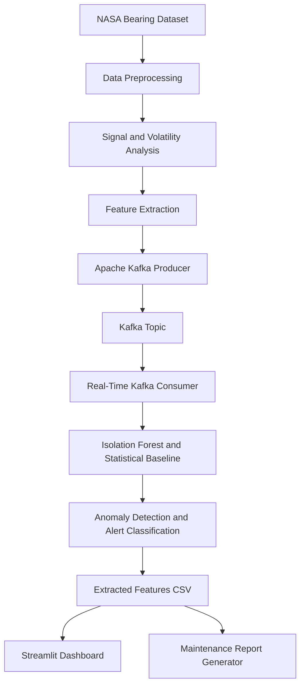
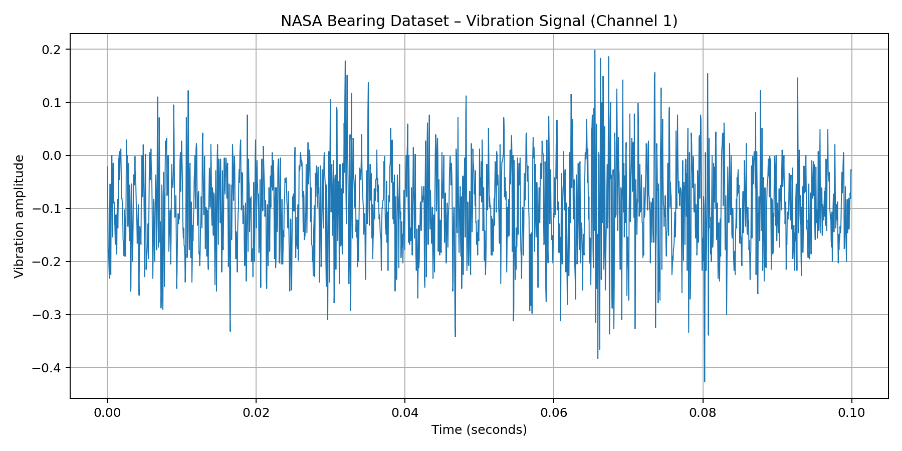
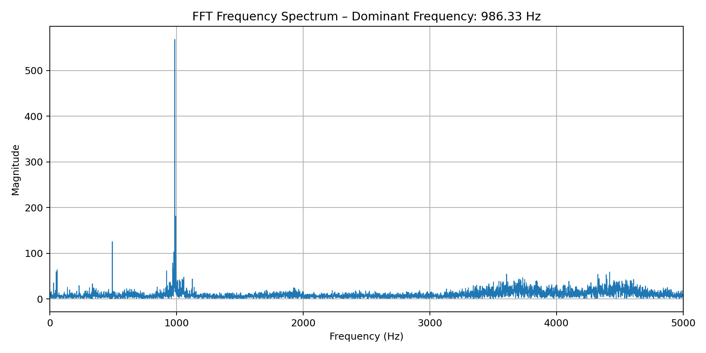
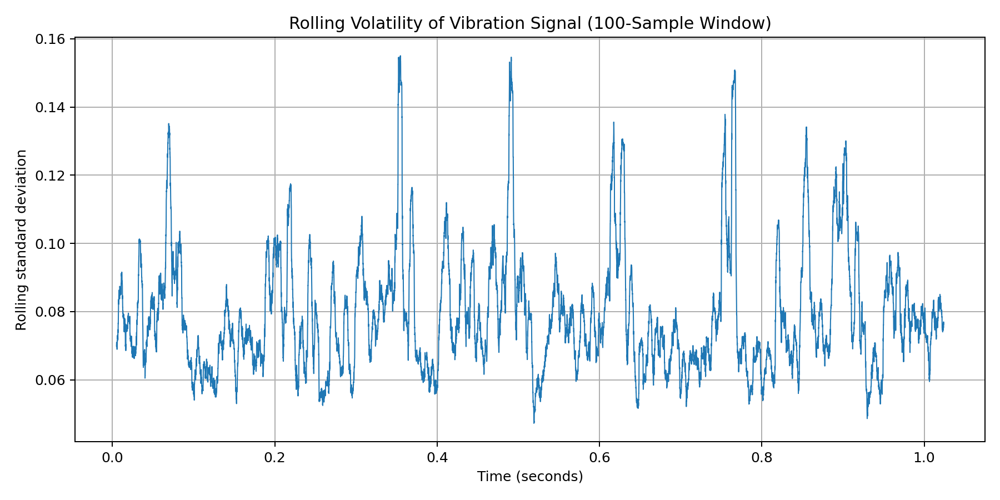
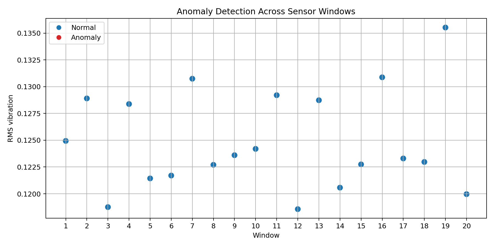
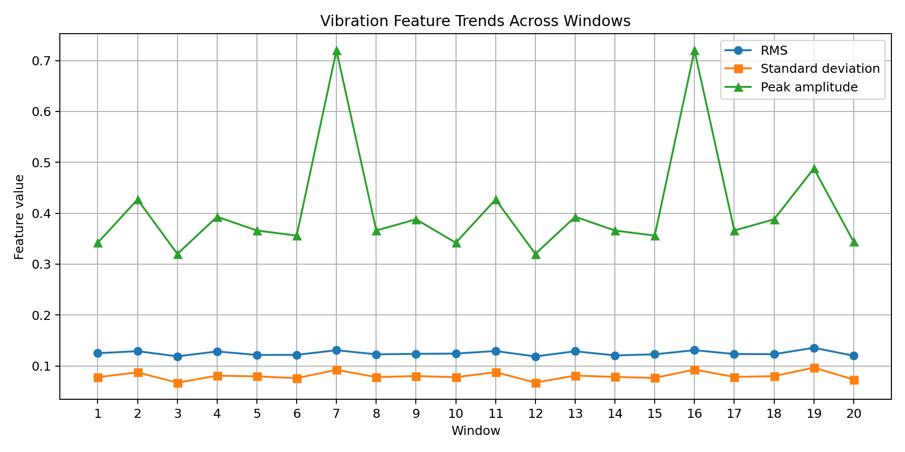
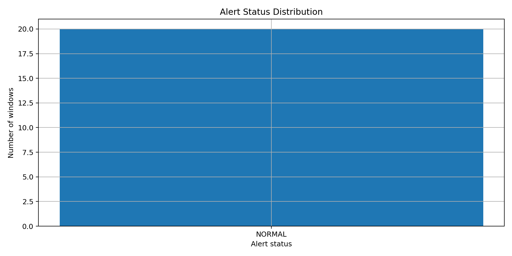

# Sensor Telemetry Analytics and Anomaly Detection

## Project Overview

Sensor Telemetry Analytics and Anomaly Detection is a real-time condition-monitoring project developed using NASA Bearing sensor data. The system processes vibration signals, extracts statistical and frequency-domain features, detects abnormal sensor behaviour, and presents monitoring results through an interactive dashboard.

The project aims to identify potential abnormal bearing behaviour through data preprocessing, signal analysis, machine learning, and real-time streaming.

## Project Objectives

- Process and clean NASA Bearing vibration sensor data.
- Perform exploratory data analysis and frequency-domain analysis.
- Calculate rolling volatility and statistical features.
- Detect abnormal sensor behaviour using statistical thresholds and Isolation Forest.
- Stream sensor readings through Apache Kafka.
- Extract features from real-time sensor windows.
- Visualize sensor behaviour and anomaly alerts through Streamlit.
- Generate automated maintenance incident reports.

## System Architecture



## Technologies Used

| Category | Technologies |
|---|---|
| Programming Language | Python |
| Data Processing | Pandas, NumPy |
| Data Visualization | Matplotlib, Seaborn, Streamlit |
| Machine Learning | Scikit-learn, Isolation Forest |
| Signal Processing | SciPy, PyWavelets |
| Anomaly Detection | Statistical Thresholding, Matrix Profile |
| Streaming | Apache Kafka |
| Dataset | NASA Bearing Dataset |
| Development Tools | VS Code, Jupyter Notebook, Git, GitHub |

## Project Development – Weekly Progress

### Week 1 – Data Collection and Preprocessing

**Objective:** Prepare the NASA Bearing dataset for further analysis.

**Tasks completed:**
- Explored and organized the NASA Bearing dataset.
- Inspected raw sensor files and their structure.
- Implemented data preprocessing using Python.
- Handled temporary and invalid files during data loading.
- Processed eight vibration sensor channels.
- Implemented rolling volatility calculations using a 100-sample window.
- Generated cleaned sensor data for subsequent analysis.
- Configured `.gitignore` to exclude large raw and generated datasets.

**Key outcome:** Developed the preprocessing pipeline to prepare sensor readings for analytical processing.

### Week 2 – Exploratory Data Analysis and Signal Processing

**Objective:** Understand vibration patterns and identify unusual sensor behaviour.

**Tasks completed:**
- Performed statistical analysis of vibration signals.
- Implemented Fast Fourier Transform (FFT) for frequency-domain analysis.
- Identified the dominant non-zero frequency component.
- Implemented Matrix Profile analysis using STUMPY.
- Performed wavelet-based signal analysis.
- Developed a statistical baseline using a rolling window and three-standard-deviation threshold.
- Generated statistical analysis results.

**Key observations:**
- Dominant frequency identified: approximately 986.33 Hz.
- Matrix Profile window size: 150.
- Statistical baseline identified 114 potential anomalous samples among 20,380 evaluated samples (approximately 0.559%).

**Key outcome:** Established signal-analysis and statistical anomaly-detection methods.

### Week 3 – Real-Time Streaming and Machine Learning

**Objective:** Develop a real-time sensor monitoring and anomaly-detection pipeline.

**Tasks completed:**
- Implemented a Kafka producer to stream sensor readings.
- Developed a Kafka consumer to process incoming sensor messages.
- Implemented feature extraction using vibration data.
- Extracted the following features:
  - Mean
  - Root Mean Square (RMS)
  - Standard Deviation
  - Peak Amplitude
  - Kurtosis
  - Crest Factor
  - Dominant Frequency
- Integrated an Isolation Forest model for anomaly detection.
- Implemented a statistical baseline for vibration monitoring.
- Developed alert classifications:
  - NORMAL
  - WARNING
  - CRITICAL
- Implemented a Streamlit dashboard to visualize sensor features, anomaly results, and monitoring information.

**Key outcome:** Developed a bounded real-time streaming demonstration using Kafka, machine learning, and a monitoring dashboard.

### Week 4 – Reporting, Load Testing and Documentation

**Objective:** Improve monitoring, reporting, testing, and project documentation.

**Tasks completed:**

**1. Dashboard Improvements**
- Improved the Streamlit monitoring dashboard.
- Added sensor feature trends and anomaly monitoring.
- Included health score and estimated remaining useful life (RUL) indicators.

**2. Maintenance Reporting**
- Developed `Maintenance_reporter.py`.
- Implemented anomaly-based maintenance report generation.
- Included window information, peak amplitude, dominant frequency, and alert status.
- Tested report generation with normal and simulated anomalous data.

**3. Load Testing Preparation**
- Developed `load_testing/kafka_load_producer.py`.
- Added configurable message-generation modes:
  - Normal load
  - High load
  - Burst load
- Implemented message delivery counters and throughput calculation.
- Prepared CSV-based load-test result logging.

**Note:** Full Kafka load testing remains pending because the local Kafka broker encountered startup and file-access issues.

**4. Documentation**
- Prepared project documentation.
- Organized implementation details and execution instructions.
- Prepared visualizations for the GitHub README.

## Machine Learning and Anomaly Detection

### Isolation Forest

Isolation Forest is used to identify unusual sensor patterns based on vibration readings across eight sensor channels.

The model predicts whether sensor observations are normal or anomalous.

### Statistical Baseline

A rolling statistical baseline is used to monitor vibration behaviour.

The system uses a three-standard-deviation threshold to identify potential deviations from the baseline.

### Alert Classification

| Alert | Description |
|---|---|
| NORMAL | No configured anomaly or baseline alert |
| WARNING | Statistical baseline threshold exceeded |
| CRITICAL | Machine learning anomaly condition detected |

## Feature Extraction

The system extracts seven features from each vibration window.

| Feature | Description |
|---|---|
| Mean | Average vibration amplitude |
| RMS | Root Mean Square vibration level |
| Standard Deviation | Measures signal variation |
| Peak Amplitude | Maximum absolute vibration amplitude |
| Kurtosis | Describes signal distribution and peak characteristics |
| Crest Factor | Ratio of peak amplitude to RMS |
| Dominant Frequency | Frequency component with the highest non-zero FFT magnitude |

**Processing configuration:**
- Sampling rate: 20,000 Hz
- Window size: 1,024 samples
- Sensor channels: 8

## Project Results

The following results were obtained during the bounded streaming demonstration:

| Metric | Result |
|---|---:|
| Sensor readings in input dataset | 20,480 |
| Sensor channels | 8 |
| Processing window size | 1,024 |
| Feature windows processed | 20 |
| Anomalous windows in the demonstrated run | 0 |
| Normal windows | 20 |
| Dominant frequency from full signal FFT | 986.33 Hz |

**Observation:** All 20 processed windows were classified as NORMAL in the demonstrated run. This does not establish that the bearing is failure-free; anomaly detection results depend on the dataset, model, and configured thresholds.

## Project Visualizations

The following graphs illustrate the sensor signal, frequency characteristics, volatility, anomaly results, and feature trends.

### 1. Vibration Signal

Displays the vibration amplitude over time for the first sensor channel.



### 2. FFT Frequency Spectrum

Shows the frequency-domain representation of the vibration signal and its dominant non-zero frequency component.



### 3. Rolling Volatility

Illustrates changes in vibration variability using a rolling standard deviation calculated over 100 samples.



### 4. Anomaly Detection

Displays RMS vibration values across processed windows and highlights detected anomalous windows.



### 5. Feature Trends

Visualizes changes in RMS, standard deviation, and peak amplitude across processing windows.



### 6. Alert Status Distribution

Shows the distribution of NORMAL, WARNING, and CRITICAL alert statuses.



## Project Structure

```text
Sensor_Telemetry_Analytics/
│
├── data/
│   ├── raw/
│   └── cleaned/
│
├── images/
│   ├── vibration_signal.png
│   ├── fft_frequency_spectrum.png
│   ├── rolling_volatility.png
│   ├── anomaly_detection.png
│   ├── feature_trends.png
│   └── alert_status_distribution.png
│
├── load_testing/
│   └── kafka_load_producer.py
│
├── notebooks/
│   └── task2_data_analysis.ipynb
│
├── src/
│   ├── preprocessing.py
│   └── volatility_analysis.py
│
├── dashboard.py
├── data_cleaner.py
├── feature_extraction.py
├── frequency_eda.py
├── matrix_profile_analysis.py
├── statistical_baseline.py
├── wavelet_analysis.py
├── sensor_streamer.py
├── realtime_consumer.py
├── Maintenance_reporter.py
├── train_isolation_forest.py
├── test_alert_conditions.py
├── requirements.txt
└── README.md
```

## Installation and Setup

### 1. Clone the Repository

```bash
git clone -b Hafeeza https://github.com/PeriManya/Sensor-Telemetry-Anomaly-detection-.git
```

Navigate to the cloned repository directory.

### 2. Create a Virtual Environment

```bash
python -m venv venv
```

Activate it on Windows:

```powershell
.\venv\Scripts\Activate
```

### 3. Install Dependencies

```bash
pip install -r requirements.txt
```

### 4. Dataset Configuration

Place the required NASA Bearing dataset in the project root using the expected filename:

```text
dataset.csv
```

The streaming and feature-extraction scripts expect this input file. The raw dataset is excluded from GitHub through `.gitignore`.

## Running the Project

Run the following scripts from the project root directory.

### Data Preprocessing

```bash
python data_cleaner.py
```

### Signal Analysis

```bash
python frequency_eda.py
```

```bash
python matrix_profile_analysis.py
```

```bash
python wavelet_analysis.py
```

```bash
python statistical_baseline.py
```

### Train Isolation Forest

```bash
python train_isolation_forest.py
```

### Start Kafka Producer

```bash
python sensor_streamer.py
```

### Start Kafka Consumer

```bash
python realtime_consumer.py
```

**Prerequisite:** A configured and running local Kafka broker at `localhost:9092`, with the required Kafka topic available.

### Launch Streamlit Dashboard

```bash
streamlit run dashboard.py
```

### Generate Maintenance Report

```bash
python Maintenance_reporter.py
```

The maintenance report is generated from `extracted_features.csv` and saved as `maintenance_report.txt`.

### Prepare Kafka Load Testing

```bash
python load_testing/kafka_load_producer.py --help
```

This displays the available load-testing options. Run actual load tests only after the Kafka broker is configured and running.

## Limitations

- The current real-time consumer is a bounded streaming demonstration rather than an indefinitely running production service.
- Full Kafka load testing has not yet been completed.
- The maintenance report is generated through a manually executed script; automatic notification integration is not implemented.
- Health score and remaining useful life (RUL) values are illustrative indicators, not validated predictive maintenance estimates.
- Anomaly flags indicate potential abnormal behaviour and do not confirm mechanical failure.
- The dashboard depends on the generated feature CSV being available.
- The raw NASA dataset is not included in the GitHub repository and must be configured separately.

## Future Enhancements

- Complete end-to-end Kafka load and performance testing.
- Implement automated maintenance alerts and notifications.
- Improve anomaly detection through additional machine learning models.
- Develop a validated remaining useful life prediction model.
- Integrate database storage for historical sensor information.
- Improve dashboard monitoring and reporting capabilities.
- Explore deployment using Docker and cloud-based infrastructure.

## Conclusion

The Sensor Telemetry Analytics and Anomaly Detection project demonstrates the use of data preprocessing, signal processing, machine learning, and real-time streaming for vibration-based equipment monitoring.

By combining Apache Kafka, Isolation Forest, statistical analysis, and Streamlit visualization, the project provides a foundation for identifying potential abnormal bearing behaviour and supporting predictive maintenance workflows.

---

**Project Repository:** [Sensor Telemetry Anomaly Detection](https://github.com/PeriManya/Sensor-Telemetry-Anomaly-detection-)

**Development Branch:** `Hafeeza ,Manya and Sowmya`

**Project Domain:** Data Science | Machine Learning | Real-Time Analytics | Predictive Maintenance
